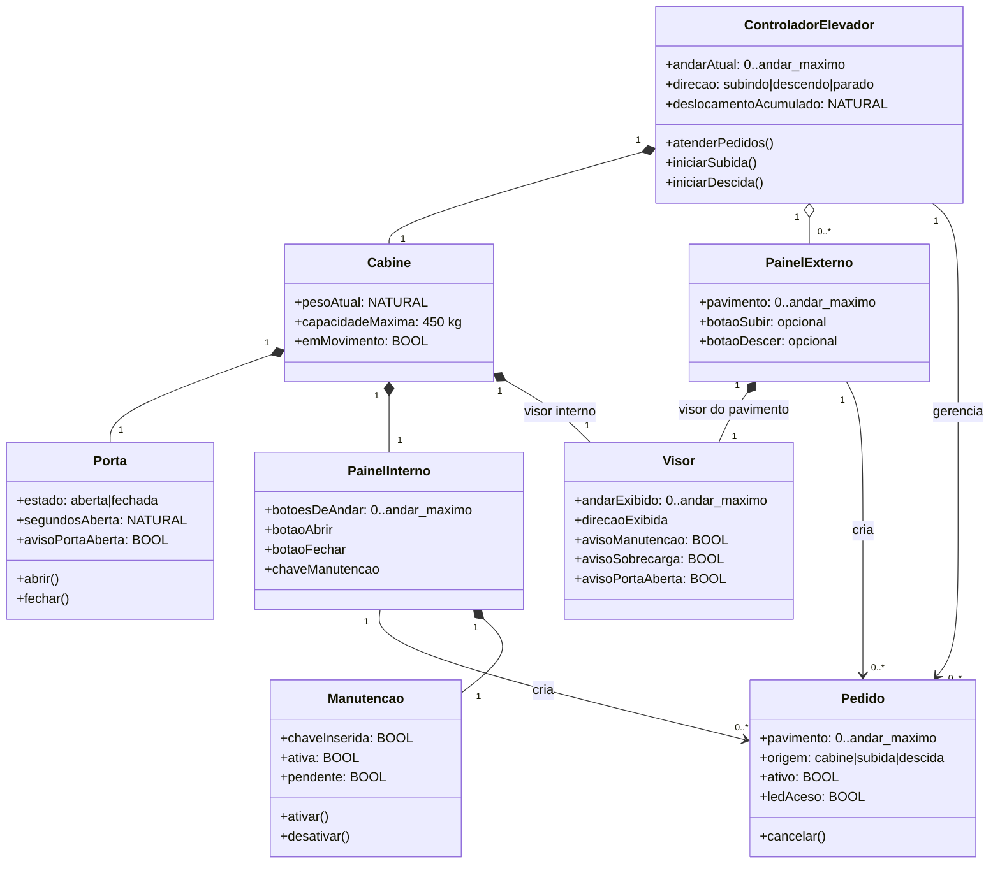

# Diagrama de entidades — Controle de Elevador

Este diagrama organiza os elementos que o projeto deve representar. Ele é um
modelo de análise: na especificação B, parte dessas entidades aparece como
variáveis e conjuntos, e não necessariamente como classes implementadas.

## O que cada entidade deve possuir

| Entidade | Deve possuir | Cobertura no modelo B |
|---|---|---|
| Controlador do elevador | Andar atual, direção, regra de deslocamento e atendimento dos pedidos. | `andar`, `direcao`, `deslocamento` e operações de movimento. |
| Cabine | Posição, peso atual e limite de 450 kg; não pode mover-se em sobrecarga. | `andar`, `peso`, `peso_maximo`. |
| Porta | Estado aberta/fechada, contador de segundos aberta e alerta após dois minutos. | `porta`, `segundos_porta_aberta`, `aviso_porta_aberta`. |
| Painel interno | Botões dos andares, abrir, fechar e chave de manutenção. | `pressionar_interno`, `pressionar_abrir`, `pressionar_fechar` e operações de manutenção. |
| Painel externo | Botão de subida em `0..(andar_maximo - 1)` e de descida em `1..andar_maximo`. | `pressionar_externo_subida` e `pressionar_externo_descida`. |
| Pedido | Pavimento, origem, estado ativo, LED e possibilidade de cancelamento. | `pedidos_internos`, `pedidos_subida` e `pedidos_descida`; `consultar_leds` combina os pedidos com as fases de piscada. |
| Visor | Andar e direção; alertas de porta aberta, manutenção e sobrecarga conforme sua localização. | `consultar_visores` retorna todas as informações e respeita a localização de cada alerta. |
| Manutenção | Chave inserida, estado ativo ou pendente, cancelamento dos pedidos e bloqueio dos painéis. | `chave_manutencao`, `manutencao`, `manutencao_pendente`. |

## Regras essenciais

- A cabine só se move com a porta fechada, fora de manutenção e sem sobrecarga.
- No estado estável, todo pedido mantém seu LED aceso até atendimento ou
  cancelamento. As quatro fases de piscada alteram temporariamente essa saída.
- O pedido interno final não pode ser cancelado: seu LED deve piscar e continuar aceso.
- Em manutenção, pedidos ativos são cancelados e os novos pedidos não são aceitos.
- Cada visor deve refletir o andar e a direção atuais da cabine.
